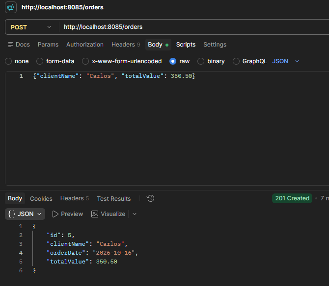
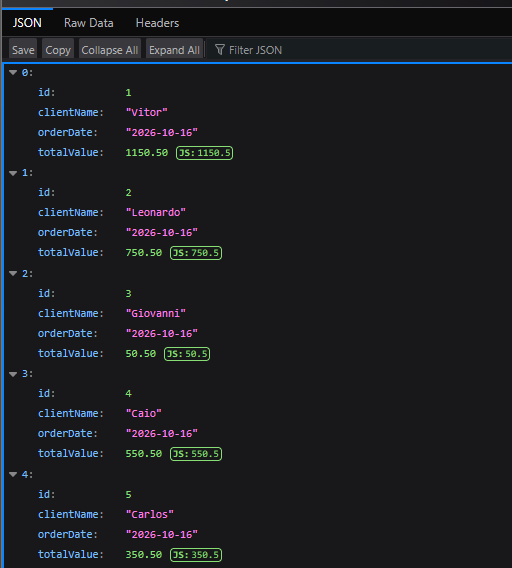
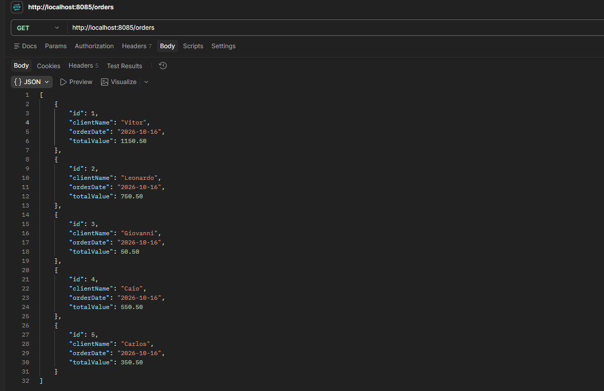
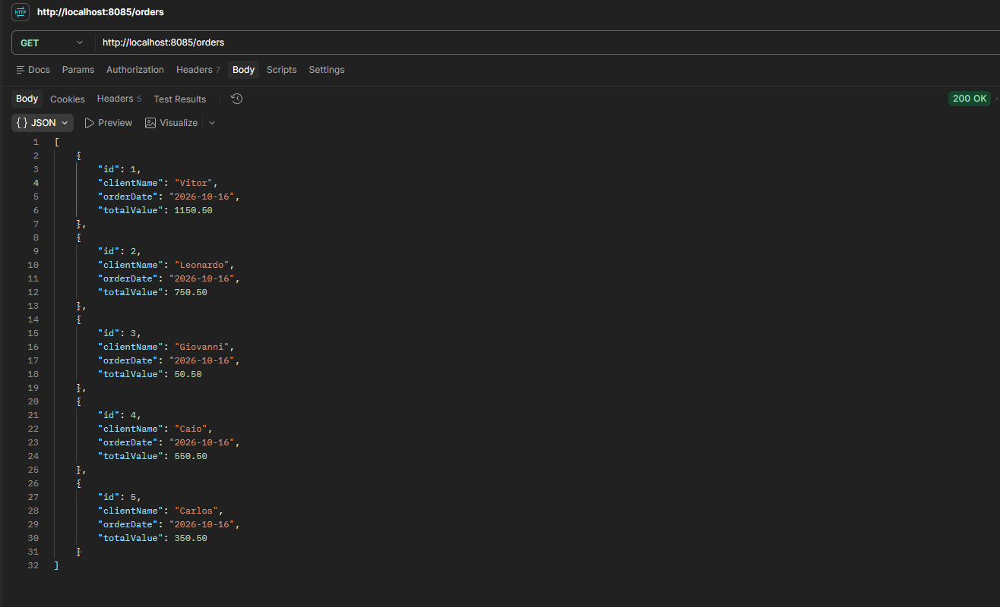
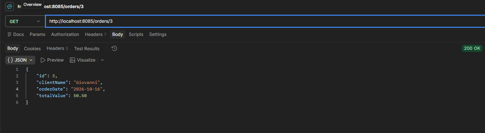
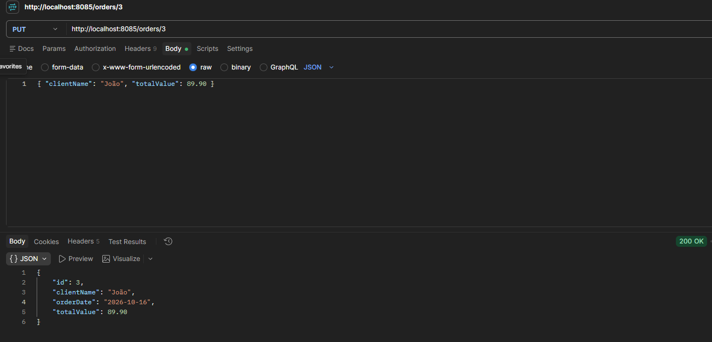
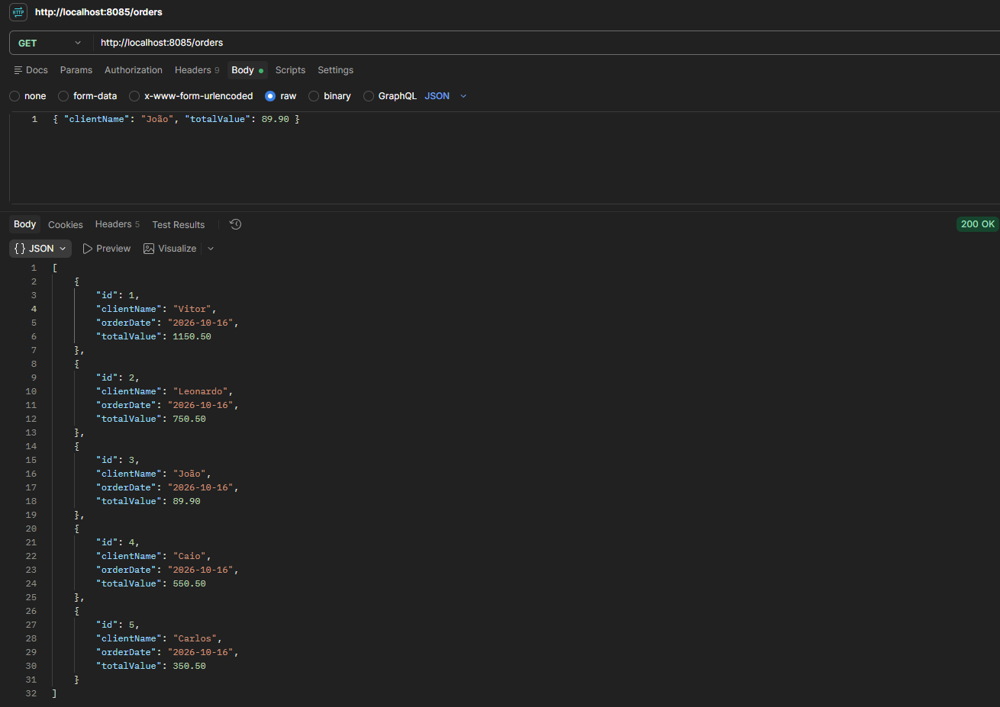
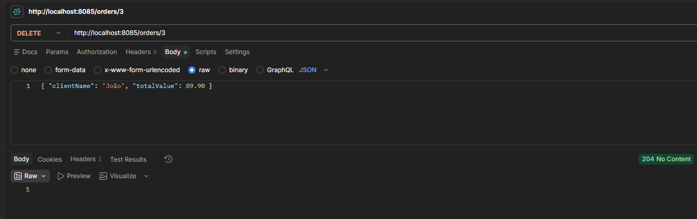
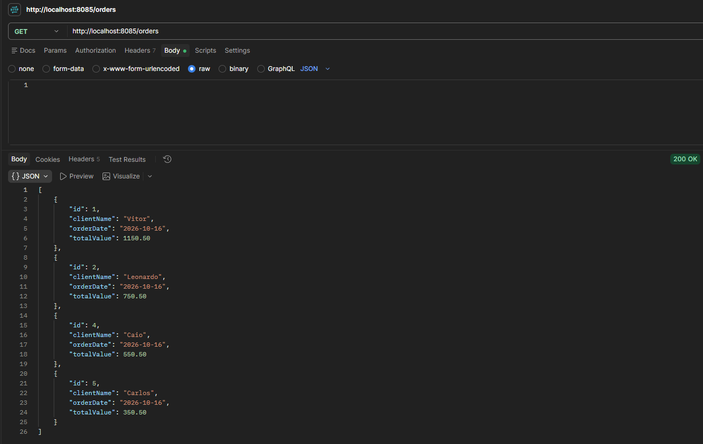

# Checkpoint 2 — API de pedidos com Spring Boot

Projeto acadêmico desenvolvido com base no roteiro **Aplicação CRUD com Spring Boot**. A aplicação disponibiliza uma API REST para cadastrar, consultar, atualizar e excluir pedidos, com persistência em um banco de dados H2 em memória cuja estrutura é criada por migrations do Flyway.

## Integrantes

| Nome completo | RM |
| --- | --- |
| Leonardo Fernandes Mesquita | 559623 |
| Vitor de Lima Domingues | 561008 |
| Giovanni Romano Provazi | 560434 |
| Caio Berardo de Araújo | 560357 |

**Turma:** 3ESPA  
**Disciplina:** SOA e Web Services

## Tecnologias

- Java 21.
- Spring Boot 4.1.1.
- Maven, com Maven Wrapper incluído no projeto.
- Spring Web para disponibilizar os endpoints REST.
- Spring Data JPA e Hibernate para persistência e mapeamento da entidade.
- H2 Database, executado em memória.
- Flyway para versionar e criar a estrutura do banco por meio de migrations SQL.
- Jakarta Validation para validação dos dados.
- Lombok para geração de getters, setters e construtores.
- Spring Boot DevTools para apoio ao desenvolvimento.
- Spring Boot Starter Test para execução dos testes.

## Funcionalidades

- Cadastrar um pedido.
- Listar todos os pedidos.
- Consultar um pedido pelo identificador.
- Atualizar o nome do cliente e o valor total de um pedido.
- Excluir um pedido.
- Validar o nome do cliente e o valor informado.
- Preencher a data atual antes da inserção quando a data não for informada.
- Retornar HTTP 404 nas operações por identificador quando o pedido não existir.

## Estrutura das pastas

Os caminhos abaixo são relativos à raiz do projeto, onde fica o arquivo `pom.xml`.

| Pasta ou arquivo | Responsabilidade |
| --- | --- |
| `pom.xml` | Dependências, versão do Java e configuração do build Maven. |
| `mvnw` e `mvnw.cmd` | Execução do Maven Wrapper no Linux/macOS e Windows. |
| `.mvn/wrapper/` | Configuração do Maven Wrapper. |
| `src/main/java/br/com/fiap3espa/checkpoint2/` | Pacote principal da aplicação. |
| `src/main/java/br/com/fiap3espa/checkpoint2/Checkpoint2Application.java` | Classe principal que inicializa o Spring Boot. |
| `src/main/java/br/com/fiap3espa/checkpoint2/controller/OrderController.java` | Recebe requisições HTTP e define as respostas da API. |
| `src/main/java/br/com/fiap3espa/checkpoint2/service/OrderService.java` | Implementa as operações de cadastro, consulta, atualização e exclusão. |
| `src/main/java/br/com/fiap3espa/checkpoint2/repository/OrderRepository.java` | Interface que estende `JpaRepository` para acesso ao banco. |
| `src/main/java/br/com/fiap3espa/checkpoint2/model/OrderModel.java` | Entidade que representa os pedidos e suas validações. |
| `src/main/resources/application.properties` | Configurações da aplicação, do banco H2 e do Flyway. |
| `src/main/resources/db/migration/V1__create_order_table.sql` | Migration do Flyway que cria a tabela `orders`. |
| `src/test/java/br/com/fiap3espa/checkpoint2/Checkpoint2ApplicationTests.java` | Teste de carregamento do contexto do Spring. |
| `docs/prints/` | Capturas de tela que comprovam a execução das operações do CRUD. |
| `target/` | Arquivos gerados pela compilação; não contém o código-fonte a ser editado. |

## Organização da aplicação

O `OrderController` recebe a requisição e chama o `OrderService`. O serviço utiliza o `OrderRepository` para consultar ou alterar os dados no H2. A classe `OrderModel` define a entidade persistida na tabela `orders`.

O projeto usa o pacote `br.com.fiap3espa.checkpoint2` e a classe principal `Checkpoint2Application`. A propriedade `spring.application.name` está definida como `checkpoint2`; ela não altera os pacotes nem os endpoints.

## Entidade e banco de dados

A anotação `@Table(name = "orders")` define o nome da tabela. A estrutura da tabela não é gerada pelo Hibernate: ela é criada pelo Flyway a partir da migration `V1__create_order_table.sql`. A configuração `spring.jpa.hibernate.ddl-auto=validate` faz o Hibernate apenas conferir, na inicialização, se a tabela criada pela migration corresponde à entidade.

| Atributo | Coluna | Descrição |
| --- | --- | --- |
| `id` | `id BIGINT` | Identificador do pedido, gerado automaticamente pelo banco (`AUTO_INCREMENT`) com a estratégia `IDENTITY`. |
| `clientName` | `client_name VARCHAR(255)` | Nome do cliente, validado com `@NotEmpty`. |
| `orderDate` | `order_date DATE` | Data do pedido, representada por `LocalDate`. |
| `totalValue` | `total_value DECIMAL(10,2)` | Valor total, representado por `BigDecimal`, validado com `@DecimalMin` (exclusivo) e `@Positive`. |

O nome não pode ser nulo ou vazio. Quando informado, o valor total deve ser maior que zero. As anotações numéricas utilizadas não tornam o campo obrigatório por si só; porém, a coluna `total_value` é `NOT NULL`, portanto um pedido sem valor é rejeitado pelo banco. O método anotado com `@PrePersist` atribui a data atual quando `orderDate` está nulo.

A atualização modifica apenas `clientName` e `totalValue`, preservando o identificador e a data do pedido existente.

O banco é mantido em memória, por meio da URL `jdbc:h2:mem:checkpoint2`. A cada inicialização o banco começa vazio, o Flyway aplica a migration e cria a tabela novamente. Os registros são perdidos quando a aplicação é encerrada.

## Como executar

1. Instale e configure o JDK 21.
2. Abra a pasta do projeto na IDE ou no terminal.
3. No terminal, acesse a pasta que contém o `pom.xml`.
4. Confira o Java utilizado pelo Maven e inicie a aplicação.

### Linux ou macOS

```bash
bash mvnw -version
bash mvnw spring-boot:run
```

### Windows — PowerShell

```powershell
.\mvnw.cmd -version
.\mvnw.cmd spring-boot:run
```

O comando de versão deve indicar Java 21 ou superior. O Maven Wrapper pode precisar de acesso à internet na primeira execução para baixar o Maven e as dependências.

Também é possível executar o método `main` da classe `Checkpoint2Application` pela IDE.

Na inicialização, o log deve exibir as mensagens abaixo, indicando que o Flyway criou a tabela e que a aplicação está pronta na porta 8085:

```text
Successfully applied 1 migration to schema "PUBLIC", now at version v1
Tomcat started on port 8085 (http) with context path '/'
Started Checkpoint2Application in ... seconds
```

A API fica disponível em [http://localhost:8085/orders](http://localhost:8085/orders). Uma resposta `[]` indica que não existem pedidos cadastrados. A aplicação não inclui uma interface gráfica própria; as operações são realizadas pelos endpoints REST.

## Endpoints

URL base: `http://localhost:8085`.

Nas rotas, `{id}` representa o identificador do pedido e é recebido pelo parâmetro Java `id` por meio de `@PathVariable("id")`.

| Método HTTP | Rota | Operação | Resposta de sucesso |
| --- | --- | --- | --- |
| `POST` | `/orders` | Cadastrar pedido | `201 Created`, com o pedido salvo. |
| `GET` | `/orders` | Listar pedidos | `200 OK`, com uma lista, que pode estar vazia. |
| `GET` | `/orders/{id}` | Consultar pedido pelo ID | `200 OK`, com o pedido encontrado. |
| `PUT` | `/orders/{id}` | Atualizar nome e valor | `200 OK`, com o pedido atualizado. |
| `DELETE` | `/orders/{id}` | Excluir pedido | `204 No Content`, sem corpo de resposta. |

As operações por ID retornam `404 Not Found` quando o pedido não existe; no `GET` e no `PUT` o corpo traz uma mensagem de erro, e no `DELETE` a resposta vem sem corpo. Dados que violem as validações do corpo das requisições POST e PUT resultam em `400 Bad Request`.

## Exemplos de utilização

Com a aplicação em execução, os comandos abaixo podem ser usados em um terminal Bash com `curl`. Para atualizar, consultar ou excluir, substitua o ID `1` pelo identificador retornado no cadastro.

### Cadastrar

```bash
curl -i -X POST http://localhost:8085/orders \
  -H 'Content-Type: application/json' \
  -d '{"clientName":"Ana Silva","totalValue":150.00}'
```

O corpo não inclui `id`, pois ele é gerado pelo banco. A data foi omitida para que seja preenchida automaticamente. Para informar uma data, utilize o formato `AAAA-MM-DD` no campo `orderDate`.

### Listar

```bash
curl -i http://localhost:8085/orders
```

### Consultar pelo ID

```bash
curl -i http://localhost:8085/orders/1
```

### Atualizar

```bash
curl -i -X PUT http://localhost:8085/orders/1 \
  -H 'Content-Type: application/json' \
  -d '{"clientName":"Ana Souza","totalValue":200.00}'
```

### Excluir

```bash
curl -i -X DELETE http://localhost:8085/orders/1
```

## Evidências dos testes

Os prints abaixo registram a execução das operações do CRUD com a aplicação rodando localmente na porta 8085, utilizando o Postman e o navegador. Antes das capturas, foram cadastrados cinco pedidos (IDs 1 a 5); em seguida, o pedido de ID 3 foi consultado, atualizado e excluído. As imagens ficam na pasta `docs/prints/`.

### 1. Cadastrar pedido — `POST /orders`

Envio do corpo `{"clientName": "Carlos", "totalValue": 350.50}`. A API responde `201 Created` com o pedido salvo: o `id` 5 foi gerado pelo banco e a `orderDate` foi preenchida automaticamente com a data atual pelo método `@PrePersist`.



### 2. Listar pedidos pelo navegador — `GET /orders`

Acesso a `http://localhost:8085/orders` diretamente pelo navegador, exibindo os cinco pedidos cadastrados (Vitor, Leonardo, Giovanni, Caio e Carlos).



### 3. Listar pedidos pelo Postman — `GET /orders`

A mesma listagem realizada pelo Postman, retornando um array JSON com os cinco pedidos.



### 4. Listar pedidos com status da resposta — `GET /orders`

Listagem pelo Postman exibindo também o status `200 OK` da resposta.



### 5. Consultar pedido pelo ID — `GET /orders/3`

Consulta do pedido de ID 3. A API responde `200 OK` com os dados do pedido do cliente Giovanni, no valor de 50.50.



### 6. Atualizar pedido — `PUT /orders/3`

Envio do corpo `{"clientName": "João", "totalValue": 89.90}` para o pedido de ID 3. A API responde `200 OK` com o pedido atualizado; o `id` e a `orderDate` foram preservados, e apenas o nome do cliente e o valor total foram alterados.



### 7. Conferir a atualização — `GET /orders`

Nova listagem após a atualização: o pedido de ID 3 passa a exibir o cliente João e o valor 89.90, enquanto os demais pedidos permanecem inalterados.



### 8. Excluir pedido — `DELETE /orders/3`

Exclusão do pedido de ID 3. A API responde `204 No Content`, sem corpo de resposta. O corpo JSON visível no Postman é apenas um resíduo da requisição anterior e é ignorado pelo endpoint de exclusão.



### 9. Conferir a exclusão — `GET /orders`

Listagem após a exclusão: restam os pedidos de IDs 1, 2, 4 e 5, confirmando que o pedido de ID 3 foi removido do banco.



## Migrations do banco com Flyway

O Flyway executa automaticamente, na inicialização da aplicação, os arquivos SQL da pasta `src/main/resources/db/migration`. Cada arquivo precisa seguir a convenção de nome `V<versão>__<descrição>.sql` (com dois sublinhados); arquivos fora desse padrão são ignorados.

A migration atual cria a tabela de pedidos:

```sql
CREATE TABLE orders (
    id BIGINT AUTO_INCREMENT PRIMARY KEY,
    client_name VARCHAR(255) NOT NULL,
    order_date DATE NOT NULL,
    total_value DECIMAL(10,2) NOT NULL
);
```

Para alterar a estrutura do banco, crie uma nova migration com a próxima versão (por exemplo, `V2__adiciona_coluna.sql`) em vez de editar uma migration já aplicada, e ajuste a entidade `OrderModel` de forma correspondente, já que o Hibernate valida o mapeamento na inicialização.

## Testes

Para executar os testes no Linux ou macOS:

```bash
bash mvnw test
```

No Windows — PowerShell:

```powershell
.\mvnw.cmd test
```

O teste `contextLoads()` verifica se o contexto da aplicação Spring consegue iniciar, incluindo a execução da migration do Flyway e a validação da entidade. Ele não testa individualmente os endpoints do CRUD. Os exemplos de requisições acima permitem conferir as operações manualmente, e a seção [Evidências dos testes](#evidências-dos-testes) mostra o resultado dessa verificação.
